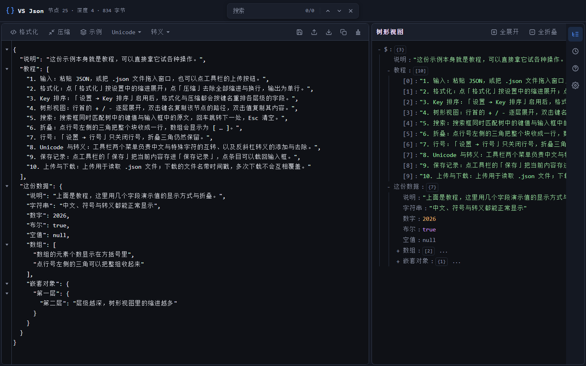
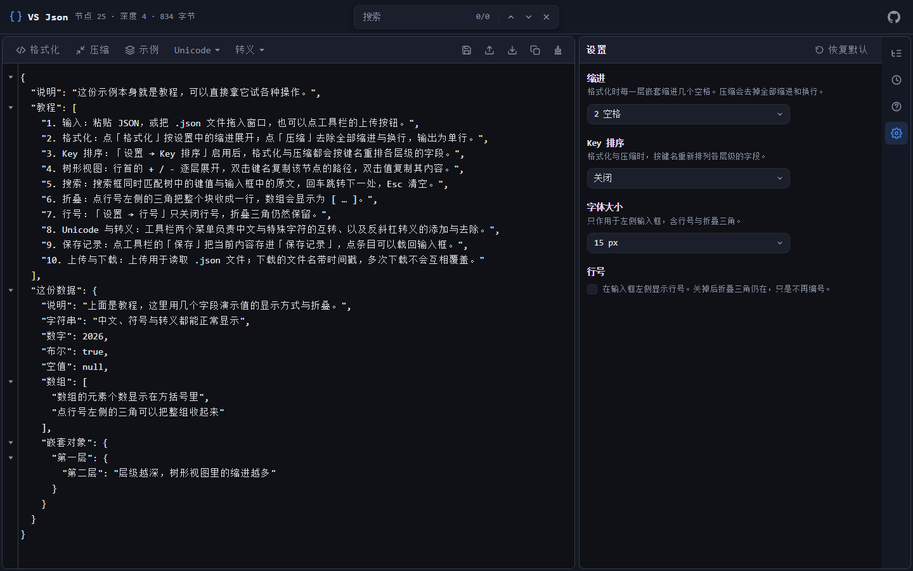

# VS Json

[](https://github.com/hyglgithub/vs-json/actions/workflows/ci.yml)
[](LICENSE)

一个单页的 JSON 查看 / 格式化工具：左边贴 JSON，右边看结构。界面照 VS Code 来——顶栏、活动栏、设置页的分组方式都是从那儿抄的。

**纯前端，没有后端**。所有 JSON 处理都在浏览器里完成，不联网、没有接口、不往任何地方发数据。

**在线使用：** <https://vs-json-one.vercel.app/>（什么都不用装）



## 功能

- **格式化 / 压缩** —— 格式化时缩进 1–4 空格可选；两者都能顺带按键名升序 / 降序重排各层级的字段
- **树形视图** —— 默认全展开，可逐层收起、全展开 / 全折叠；双击键名复制路径，双击值复制内容
- **搜索** —— 一个框同时搜树里的键值和输入框里的原文，上/下一个可按住连发
- **行号与折叠** —— 行号左侧的三角把整块收成一行；行号可关，三角留着
- **Unicode / 转义** —— 中文 ↔ `\uXXXX`，以及整篇的反斜杠转义与还原
- **保存记录** —— 手动把当前内容存下来（最多 60 条 / 2 MB），点条目载回编辑框
- **上传 / 下载 / 复制** —— 下载文件名带时间戳，窗口任意位置可拖入 `.json`
- **深色 / 浅色** —— 设置里的「主题」切换，选择会被记住；默认浅色
- **设置** —— 主题、缩进、Key 排序、字体大小（12–20px）、行号、分栏宽度，以及一键恢复默认
- **记得住** —— 关掉页面再打开，输入框还是上次的内容、右侧还是上次那个面板

窄窗口（≤900px）会自动换一套布局：顶栏只留搜索框、右侧面板改成整块盖住正文、底部四个图标横排。手机上能用，但触摸交互还没打磨（见「已知边界」）。



教程有三处：**「帮助」面板**是完整手册，**三个空白面板**各一句话指路，**点「示例」载入的那份 JSON 本身就是教程**（十条，一条一个功能）。前两处的文案出自 `lib/help.ts`。

## 快速开始

```bash
npm install
npx next dev -p 3112
```

然后打开 <http://localhost:3112/>。

> **端口写死 3112 是有原因的**：`e2e.cjs` 默认按 3112 连。`npm run dev` 没有 `-p` 参数，会跑到 3000 上去。

## 命令

```bash
npm run dev         # next dev（没有 -p，见上）
npm run build       # next build
npm run start       # next start
npm run typecheck   # tsc --noEmit —— 本项目唯一的静态检查
npm run e2e         # 冒烟测试，需要 dev server 已经在跑
```

项目里**没有**测试框架、没有 ESLint、没有 Prettier。`npm run typecheck` 就是全部质量闸门。

> 跑 `npm run build` 之前先把 `next dev` 停掉。两者共用 `.next/`，同时跑会让 dev server 500（`Cannot find module './887.js'`）。构建完记得 `rm -rf .next` 再重启 dev。
>
> `e2e.cjs` 起一个 headless Chrome，用 CDP 驱动真实页面跑六条断言。它不是测试框架，是一个脚本：靠**中文按钮文字**和 `.actions` / `.editor-front` 两个类名定位元素，所以改按钮文字或这两个类名会把它弄坏。浏览器按平台自动找，也可以用 `CHROME_PATH` 指定；被测地址用 `APP_URL` 覆盖。

## 目录结构

```
app/
  layout.tsx            服务端组件，设 metadata / viewport 并引入 globals.css
  page.tsx              纯客户端渲染（dynamic + ssr:false），只渲染 <JsonTool />
  icon.png              标签页图标（512²，矢量源在 docs/icon.svg）
  apple-icon.png        iOS 添加到主屏时的图标（180²）
  globals.css           全部样式（原生 CSS + 自定义属性，没有 Tailwind / CSS Modules）
components/
  JsonTool.tsx          全部状态与副作用都在这里；其余组件都是受控的
  Editor.tsx            四层编辑器（正文 / 命中标记 / textarea / 行号）
  JsonNode.tsx          树的一行，递归自己
  Highlight.tsx         把命中片段包成 <mark>
  Select.tsx            设置面板用的下拉（不是原生 <select>）
  Toasts.tsx            右下角的消息气泡
  Hint.tsx              空白面板里那一句话
  panels/               右侧四个面板，一个面板一个文件
    TreePanel.tsx  HistoryPanel.tsx  SettingsPanel.tsx  HelpPanel.tsx
lib/                    纯函数，不含 React、不含组件状态
  prefs.ts              偏好：PREFS_KEY、默认值、可选项清单、面板 id、校验与夹取
  draft.ts              编辑器草稿的读写（DRAFT_KEY / 上限 / 防抖时长）
  constants.ts          NL/BS 常量、toast 参数、HIST_*、SAMPLE
  json.ts               isObject / joinKey / deepSort / findMatches / foldRanges ...
  text.ts               escapeUnicode / unescapeUnicode、escapeText / unescapeText、reformatJson
  format.ts             fmtTime / fmtRel / fmtBytes / fmtFileStamp / histPreview
  help.ts               帮助与教程文案
types/assets.d.ts       *.css 的环境声明
```

分层的界线有两条：

- **`lib/` 里的函数不许看见 `useState`。** 需要状态的留在组件里。
- **组件不许自己持有业务状态。** `expanded` / `query` / `folded` / `history` 这些全在 `JsonTool` 里，其余组件通过 props 拿。唯一的例外是 `Select` 内部的 `open` / `hi` ——那是弹层自己的 UI 状态，不是业务状态。

这么分是为了二开：改树的行样式只动 `JsonNode.tsx`，改编辑器只动 `Editor.tsx`，加一个右侧面板就是在 `components/panels/` 下写一个组件、再往 `JsonTool.tsx` 里那张 `panels` 注册表加一项——活动栏按钮和面板正文都从注册表来，两边不可能对不上。

`page.tsx` 关掉了服务端渲染，这是有意的：偏好和草稿都存在 localStorage 里，只有浏览器才知道。照常服务端渲染的话，送出去的 HTML 一定带默认值，浏览器会先按默认值画一帧再跳到存的值——拖过分栏的人会看到面板边缘跳一下，有草稿的人会看到空编辑器闪一下。关掉之后 React 在第一次渲染之前就读到了存的值，第一帧就是对的。代价是首屏要等一小会儿 JS（看到的是主题底色，不会白屏）。主题本身由 `app/layout.tsx` 里一段内联脚本在样式生效前就挂好，所以选了浅色也不会先闪一帧深色。

## 数据存在哪

| 内容 | 位置 | 说明 |
| --- | --- | --- |
| 保存记录 | `localStorage["jsontool.history"]` | **键名不能改**，改了等于把已存的条目全部丢弃 |
| 主题 / 缩进 / Key 排序 / 字体大小 / 行号 / 分栏宽度 / 右侧面板 | `localStorage["jsontool.prefs"]` | 带版本号；存的格式对不上就整袋丢掉、回到默认值 |
| 输入框里的草稿 | `localStorage["jsontool.draft"]` | 单独一个键，见下 |

三个键都还叫 `jsontool.*`，项目改名成 VS Json 之后**故意没跟着改**——它们是存储键，不是品牌名，改了就是把用户已经存下的东西变成读不到的孤儿数据。

**草稿**是后来加的：关掉页面再打开，输入框恢复上次的内容。它和「保存记录」不是一回事——那边只有点「保存」才写、是一份可增删的列表；这边跟着输入自动更新、只有一个覆盖式的槽位。它单独占一个键而不是并进 `prefs`，因为正文可能有几百 KB，混进偏好袋会让「存格式对不上就整袋丢掉」的代价从「回到默认设置」变成「丢数据」。**上限 1 MB，超过就不再记住**（只在写的时候卡，存量超了也照常显示）。

「点保存才保存」那条规矩没变：编辑、格式化、载入示例都不会往保存记录里塞东西。

默认值：主题 **浅色**、树形视图 **全展开**、分栏 **左右 2:1**、行号 **关闭**（折叠三角仍在）、缩进 2 空格、字号 15px、Key 排序关闭、右侧默认开树形视图。设置面板右上角的「恢复默认」把前六项一起重置——**不动右侧面板**，因为那个按钮就长在设置面板里，一按就把人弹走太荒唐。

## 已知边界

都是有意设的上限，不是没做：

- **5 MB** —— 超过就只留格式化和压缩，树形视图停用
- **20000 行** —— 超过不画行号槽（折叠三角一起停），节点数随行数线性增长
- **60 条 / 2 MB** —— 保存记录的两个上限相互独立，大文档先撞字节额度
- **1 MB** —— 草稿的上限，超过不再自动记住
- **窄窗口字号下限 16px** —— 设置里的 12–15px 在手机上会被顶到 16，为的是不让 iOS 一聚焦就放大整页

手机端**有意没做**的（项目开发到此为止，这些是当时权衡后留下的，不是漏了）：

- 图标按钮的说明文字靠悬停触发，而触摸没有悬停——手机上只能「点一下顺带看到」，没有一个「先看标签再决定点不点」的路径
- 触摸目标偏小：折叠三角 14×24、搜索上的上/下一个 26×26，都低于 44×44 的建议值
- 树里的**双击**复制路径 / 值在手机上不可靠（双击即缩放手势），且没有长按替代
- 「把文件拖入窗口」在触摸设备上不存在，只有「上传」按钮可用
- 长文档在手机上向下滚动可能触发浏览器的下拉刷新（没加 `overscroll-behavior`）
- 输入法弹起时会把底部活动栏顶上去。试过 `interactive-widget=overlays-content`，在测试机上没起作用，**接受现状不再处理**（见 `CLAUDE.md`）

## 二开之前值得先读的

改这个项目之前读一遍 `CLAUDE.md`——它是给改代码的人写的，里面记着那些「看着可以简化、一改就坏」的地方：四层编辑器的盒子度量必须逐像素一致、`z-index` 的两处打平陷阱、控制字符为什么写成 `String.fromCharCode(...)`、哪些 localStorage 键改不得、`notify` 为什么不去重。README 说功能，`CLAUDE.md` 说为什么长这样。

## 部署

线上那份在 **Vercel**：<https://vs-json-one.vercel.app/>。项目已关联 GitHub 仓库，每次 push 到 `main` 由 Vercel 自动构建发布，仓库里**不会**有构建产物。

- 框架预设选 Next.js，构建命令就是 `next build`，不需要额外配置或环境变量。
- `metadataBase` 默认取 Vercel 注入的 `VERCEL_PROJECT_PRODUCTION_URL`；绑定自定义域名后，用 `NEXT_PUBLIC_SITE_URL` 覆盖它，否则分享卡片的图片会指向 Vercel 默认域名。
- GitHub Actions 只保留 `ci.yml`（typecheck + build）。之前的 GitHub Pages 静态导出已停用，`pages.yml` 和 `public/.nojekyll` 一并删除。

> fork 一份自己部署：在 Vercel 里 Import Git Repository，选自己的仓库，框架会自动识别为 Next.js；绑定域名后按需设置 `NEXT_PUBLIC_SITE_URL`。

## License

[MIT](LICENSE)
